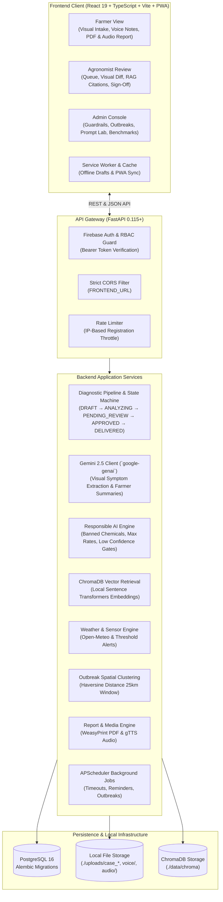
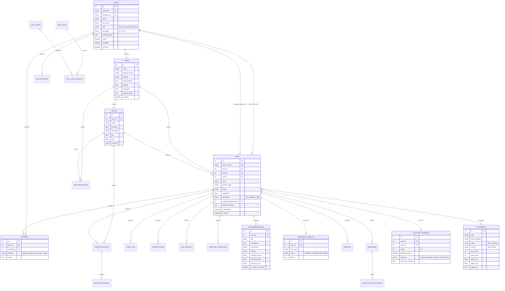

# AgriAdvisor AI - Smart Agriculture Decision Support & Guidance

AgriAdvisor AI is a full-stack, multimodal agricultural diagnostic platform designed to provide smallholder and commercial farmers with fast, reliable agronomic guidance. It combines visual crop analysis, local soil chemistry, sensor telemetry, and live weather data with Responsible AI guardrails and human-in-the-loop expert agronomist validation.

Built strictly on a **100% free stack**:
- **Multimodal AI**: Google Gemini 2.5 (`gemini-2.5-flash-lite`, `gemini-2.5-flash`) via the official `google-genai` SDK
- **Retrieval-Augmented Generation (RAG)**: Local embeddings (`sentence-transformers/all-MiniLM-L6-v2`) and ChromaDB vector store
- **Voice & Multilingual**: gTTS (Google Text-to-Speech) for English, Hindi, and Kannada audio generation; lazy translation caching
- **Weather & Geocoding**: Free Open-Meteo Weather and Geocoding APIs with coordinate coarsening for privacy
- **Document Generation**: WeasyPrint with Jinja2 and Google Noto Unicode fonts for single-page farmer PDF guidance
- **Persistence & Storage**: PostgreSQL relational database and local file storage (`./uploads`)
- **Authentication**: Firebase Authentication with custom role claims (`farmer`, `agronomist`, `admin`)

---

## 1. System Architecture



---

## 2. Entity-Relationship (ER) Diagram



---

## 3. Features by User Role

### Farmer Experience
- **Intake Wizard**: Simple step-by-step submission with crop selection, growth stage, GPS coordinate capture, and high-resolution photo upload.
- **Multilingual Voice Notes**: Record voice notes (up to 60s) in English, Hindi, or Kannada; audio converted to standard 16 kHz mono WAV.
- **Sensor Telemetry**: Upload simulated sensor report PDFs or manually enter soil moisture, temperature, and NPK readings.
- **Jargon-Free Guidance**: Clean guidance report without internal confidence percentages, citation hashes, or algorithmic flags.
- **Audio & PDF Export**: Listen to plain-language guidance in native language via gTTS audio streaming; download a 1-page WeasyPrint PDF.
- **Outcome Feedback**: Submit 1-5 star ratings and outcome results (resolved, partially resolved, not resolved) to close the diagnostic loop.

### Agronomist Experience
- **Risk-Prioritized Queue**: Cases in `PENDING_REVIEW` sorted with high uncertainty/blocked cases first, followed by oldest submitted.
- **Expert Side-by-Side Review**: Inspect crop image evidence alongside model observations, soil test results, and live weather snapshots.
- **RAG-Grounded Verification**: View university extension citations, source manuals, and chunk similarity scores supporting each recommendation.
- **Validation Actions**: One-click **Approve**, **Approve with Edits** (modify dose, chemical, or text), or **Reject** (mandatory rationale note >= 10 characters).
- **Dialogue & Two-Way Messaging**: Exchange text or voice messages with farmers; lazy automatic translation between languages.

### Administrator Experience
- **Responsible AI Guardrails**: Configure chemical dose limits, banned active ingredients, and minimum confidence thresholds for auto-approval.
- **Prompt Lab**: Live template editor with version control, side-by-side prompt comparisons, and single-click rollbacks.
- **Golden Set Benchmarks**: Run automated offline evaluation suites across 60+ curated agronomy cases with radar chart metrics.
- **Model Comparison**: Inspect live latency, weighted AgriAdvisor score, and free-tier compatibility across models; switch active model instantly.
- **Regional Outbreak Detection**: Automated spatial clustering (Haversine 25km radius) flagging watch (>=3 farms) and alert (>=6 farms) disease outbreaks.
- **Demo Data Lifecycle**: Single-click load and clean reset of demonstration scenarios without affecting production accounts.

---

## 4. Setup in 10 Steps

Follow these steps to set up AgriAdvisor AI from scratch:

1. **Clone the Repository**:
   ```bash
   git clone https://github.com/Ashu-Harshitha/mini_project.git smartagri
   cd smartagri
   ```

2. **Verify Prerequisites**:
   Ensure you have installed:
   - Python 3.11+
   - Node.js 20+ and npm
   - Docker and Docker Compose (optional for containerized run)
   - System libraries for PDF & audio processing: `ffmpeg`, `libpango-1.0-0`, `libpangoft2-1.0-0`, `fonts-noto-core`

3. **Create and Activate Python Virtual Environment**:
   ```bash
   python -m venv venv
   # On Windows (PowerShell):
   .\venv\Scripts\Activate.ps1
   # On Linux/macOS:
   source venv/bin/activate
   ```

4. **Install Backend Dependencies**:
   ```bash
   cd backend
   pip install --upgrade pip
   pip install -r requirements.txt
   ```

5. **Configure Backend Environment**:
   Copy `.env.example` to `.env` in the `backend/` directory:
   ```bash
   cp .env.example .env
   ```
   *Fill in your `GEMINI_API_KEY` (from Google AI Studio - free tier).*

6. **Run Database Migrations**:
   ```bash
   alembic upgrade head
   ```

7. **Seed Default Users and System Data**:
   ```bash
   python -m scripts.seed_users
   ```

8. **Install Frontend Dependencies**:
   ```bash
   cd ../frontend
   npm ci
   ```

9. **Configure Frontend Environment**:
   Copy `.env.example` to `.env` in the `frontend/` directory:
   ```bash
   cp .env.example .env
   ```

10. **Start Development Servers (or run Docker Compose)**:
    - **Local Development**:
      ```bash
      # Terminal 1 - Backend:
      cd backend
      uvicorn app.main:app --reload --host 0.0.0.0 --port 8000

      # Terminal 2 - Frontend:
      cd frontend
      npm run dev
      ```
    - **Single Command Docker**:
      ```bash
      # From project root:
      docker compose up --build
      ```

Access the frontend at `http://localhost:5173` and backend API documentation at `http://localhost:8000/docs`.

---

## 5. Environment Variable Reference

> [!NOTE]
> All environment variable names used across backend and frontend are listed below without values. Configure these in your private `.env` files.

### Backend Environment Variables (`backend/.env`)

| Variable Name | Description |
|---|---|
| `AI_MODE` | AI execution mode (`mock` or `gemini`) |
| `GEMINI_API_KEY` | Google Gemini API key (`google-genai` SDK) |
| `GEMINI_MODEL` | Default Gemini model identifier |
| `GEMINI_MAX_RPM` | Rate limiter threshold for Gemini calls |
| `DEFAULT_MAX_OPEN_CASES` | Maximum active cases per agronomist |
| `ASSIGN_TIMEOUT_MINUTES` | Timeout window before reassigning pending cases |
| `DATABASE_URL` | PostgreSQL or SQLite database connection URI |
| `FIREBASE_PROJECT_ID` | Firebase project identifier |
| `FIREBASE_CREDENTIALS_PATH` | Path to Firebase admin credentials JSON |
| `GOOGLE_APPLICATION_CREDENTIALS` | Google application credentials path |
| `AUTH_EMAIL_DOMAIN` | Domain appended to usernames for auth |
| `SMTP_HOST` | Outgoing SMTP server address |
| `SMTP_PORT` | SMTP port (typically 587) |
| `SMTP_USER` | SMTP username / address |
| `SMTP_PASSWORD` | SMTP app-specific password |
| `EMAIL_FROM` | From email address header |
| `FRONTEND_URL` | Allowed origin for CORS and web links |
| `FEEDBACK_DELAY_MINUTES` | Reminder interval for farmer outcome feedback |
| `DEFAULT_COUNTRY_CODE` | Default telephone prefix for notifications |
| `SMS_ENABLED` | Toggle for SMS carrier notifications |
| `TWILIO_ACCOUNT_SID` | Twilio account SID |
| `TWILIO_AUTH_TOKEN` | Twilio authorization token |
| `TWILIO_WHATSAPP_FROM` | Twilio WhatsApp sender number |
| `PROJECT_NAME` | Project name displayed in docs & headers |
| `API_V1_STR` | Prefix for versioned API endpoints |
| `UPLOAD_DIR` | Local disk directory for file uploads |
| `AUTO_APPROVE_CONFIDENCE_THRESHOLD` | Confidence cutoff for automatic advice approval |
| `MIN_FARMER_VISIBLE_CONFIDENCE` | Minimum threshold to display recommendations |
| `SENSOR_STALE_HOURS` | Hours before sensor readings are flagged stale |
| `SHOW_SAMPLE_SENSOR` | Enables sample sensor report PDF download |
| `LOCATION_MAX_ACCURACY_M` | Maximum acceptable GPS accuracy in meters |
| `WEATHER_CACHE_MINUTES` | In-memory cache duration for weather queries |
| `WEATHER_CHECK_HOURS` | Interval for automated weather check cron |
| `MAX_SENSOR_PDF_MB` | Maximum file size for sensor PDF uploads |
| `OUTBREAK_RADIUS_KM` | Spatial clustering radius in kilometers |
| `OUTBREAK_MIN_FARMS` | Minimum farms required to trigger watch alert |
| `OUTBREAK_WINDOW_DAYS` | Lookback window for active outbreak detection |
| `OUTBREAK_ALERT_FARMS` | Threshold of farms required to escalate to alert |
| `ALLOW_DEMO_DATA` | Admin authorization flag for demo seed/reset |
| `CHROMA_PATH` | Local disk path for Chroma vector embeddings |
| `RAG_TOP_K` | Number of document chunks retrieved per query |
| `RAG_MIN_RELEVANCE` | Minimum cosine relevance score threshold |

### Frontend Environment Variables (`frontend/.env`)

| Variable Name | Description |
|---|---|
| `VITE_USE_MOCKS` | Toggle between live API and mock client |
| `VITE_API_URL` | Base URL of the backend API |
| `VITE_AUTH_EMAIL_DOMAIN` | Authentication domain for user logins |
| `VITE_SHOW_DEMO_LOGINS` | Toggle demo user buttons on login screen |
| `VITE_FIREBASE_API_KEY` | Firebase web client API key |
| `VITE_FIREBASE_AUTH_DOMAIN` | Firebase authentication domain |
| `VITE_FIREBASE_PROJECT_ID` | Firebase project identifier |
| `VITE_FIREBASE_MESSAGING_SENDER_ID` | Firebase cloud messaging sender identifier |
| `VITE_FIREBASE_APP_ID` | Firebase web application identifier |

---

## 6. Management & Operational Commands

All commands should be executed from the `backend/` directory with the virtual environment activated:

```bash
# 1. Run database schema migrations
alembic upgrade head

# 2. Seed default users and chemical rules
python -m scripts.seed_users

# 3. Ingest agronomic RAG PDFs into local ChromaDB
python -m scripts.ingest_rag

# 4. Run automated Golden Set evaluation benchmark
python -m scripts.run_eval --prompt-version 1 --max-cases 20

# 5. Seed full demo scenario data (cases, farms, outbreaks, alerts)
python -m scripts.seed_demo

# 6. Reset and remove all demo scenario data
python -m scripts.seed_demo --reset
```

---

## 7. Default Credentials

The system seeds the following pre-configured accounts for development and testing:

| Role | Username | Login Email | Default Password | Initial Language | Available |
|---|---|---|---|---|---|
| **Admin** | `admin` | `admin@agriadvisor.app` | `AdminPass123!` | English | Yes |
| **Agronomist** | `sarah` | `sarah@agriadvisor.app` | `AgroPass123!` | English | Yes |
| **Agronomist** | `rajesh` | `rajesh@agriadvisor.app` | `AgroPass123!` | Hindi | Yes |
| **Farmer** | `john` | `john@agriadvisor.app` | `FarmPass123!` | English | N/A |
| **Farmer** | `ramesh` | `ramesh@agriadvisor.app` | `FarmPass123!` | Hindi | N/A |
| **Farmer** | `suresh` | `suresh@agriadvisor.app` | `FarmPass123!` | Kannada | N/A |

---

## 8. End-to-End Demonstration Script

Follow this walkthrough to experience the complete diagnostic lifecycle:

```mermaid
sequenceDiagram
    autonumber
    actor Farmer as Farmer (John)
    actor Agro as Agronomist (Sarah)
    actor Admin as Admin (Admin)
    participant API as Backend API
    participant AI as Gemini 2.5 & Guardrails

    Note over Farmer,API: Step 1: Farmer Diagnostic Intake
    Farmer->>API: Login as john / FarmPass123!
    Farmer->>API: Create case: Corn V8, upload leaf photo, record voice note in English
    Farmer->>API: Submit case (State: ANALYZING)
    API->>AI: Extract visual observations & retrieve extension guidelines
    AI-->>API: High uncertainty detected; Flagged for agronomist sign-off
    API-->>Farmer: Status: PENDING_REVIEW (Assigned to Sarah)

    Note over Agro,API: Step 2: Agronomist Review & Validation
    Agro->>API: Login as sarah / AgroPass123!
    Agro->>API: Open Review Queue (Case prioritized at top)
    Agro->>API: Inspect leaf imagery, soil NPK readings, and RAG university citation
    Agro->>API: Adjust nitrogen dose to 35 lb/ac and approve with advice notes
    API-->>Agro: Review recorded (State: APPROVED -> DELIVERED)

    Note over Farmer,API: Step 3: Farmer Receives Guidance
    Farmer->>API: Receives decision notification
    Farmer->>API: Downloads single-page PDF report; listens to audio guidance
    Farmer->>API: Submits 5-star rating & outcome feedback (State: OUTCOME_REPORTED)

    Note over Admin,API: Step 4: Administrator Oversight
    Admin->>API: Login as admin / AdminPass123!
    Admin->>API: Inspect Responsible AI safety counters (0 blocked leaks)
    Admin->>API: Open Outbreak Map (View 25km cluster around Ames, Iowa)
    Admin->>API: Run Golden Set benchmark in Prompt Lab
```

### Detailed Walkthrough Steps:

1. **Farmer Persona (`john`)**:
   - Navigate to `http://localhost:5173` and click **Farmer Demo Login** (or enter `john` / `FarmPass123!`).
   - Click **New Case**. Select crop **Corn** and growth stage **V8**.
   - Pinpoint field location using GPS or map picker.
   - Upload a leaf image showing interveinal chlorosis.
   - Click **Record Voice Note**, record a brief description ("Yellowing on lower leaves between veins"), and click **Submit Case**.
   - The case enters `PENDING_REVIEW` with an assigned agronomist.

2. **Agronomist Persona (`sarah`)**:
   - Sign out and click **Agronomist Demo Login** (`sarah` / `AgroPass123!`).
   - Click **Review Queue**. Notice John's case appears at the top prioritized by risk and uncertainty.
   - Click the case to open the side-by-side diagnostic workspace.
   - Inspect the visual observations, soil chemistry (18 ppm NO3-N), and the linked Iowa State Extension citation.
   - Click **Approve with Edits**, adjust the recommended sidedress nitrogen rate, add the expert advice note, and click **Submit Review**.
   - The status immediately transitions to `DELIVERED`.

3. **Farmer Closure (`john`)**:
   - Log back in as `john`. Open the case detail view.
   - Note the clean, jargon-free summary and validated next steps.
   - Click **Listen** to stream audio generated by gTTS.
   - Click **Download Guidance PDF** to inspect the 1-page report formatted with WeasyPrint.
   - Scroll to the bottom and click **5 Stars - Resolved** to record the outcome feedback.

4. **Administrator Persona (`admin`)**:
   - Log in as `admin` (`AdminPass123!`).
   - Open **Responsible AI & Guardrails** to inspect live safety audit counters, active chemical rules, and confidence gates.
   - Open **Outbreak Map** to observe regional disease clusters with 25km radius circles.
   - Open **Model Comparison** to view latency, weighted accuracy scores, and live active model switching.
   - Open **Settings** to inspect Demo Data status or execute an instant clean reset.

---

## 9. Limitations & Future Work

### Current System Limitations
- **Simulated Sensor Feed**: Field sensor reports currently ingest structured PDF simulations and manual inputs rather than direct live IoT MQTT / LoRaWAN gateway connections.
- **Single-Angle Visual Ingestion**: The diagnosis pipeline processes one primary crop leaf photo per diagnostic submission; full multi-angle canopy and root bundle fusion is currently sequential.
- **In-Memory Worker Queues**: Long-running background evaluation benchmarks use FastAPI `BackgroundTasks` rather than distributed Celery / Redis queues.
- **Vector Index Scale**: Local ChromaDB index is optimized for up to ~10,000 document chunks; larger collections will benefit from an external dedicated Milvus or pgvector deployment.

### Future Roadmap
- **Direct LoRaWAN & Soil Sensor Ingestion**: Real-time MQTT telemetry pipelines streaming continuous moisture, EC, and soil temperature directly from field sensors.
- **Offline Drone & Satellite Canopy Indices**: Ingestion of multispectral NDVI / NDRE imagery layers from Sentinel-2 or farm drones.
- **Edge Deployment**: On-device quantization of small vision models (e.g., MobileNet / Gemma) for remote field operation without internet connectivity.
- **WhatsApp Two-Way Conversational Gateway**: Full bidirectional conversational diagnostic flow directly through the WhatsApp Business API.
